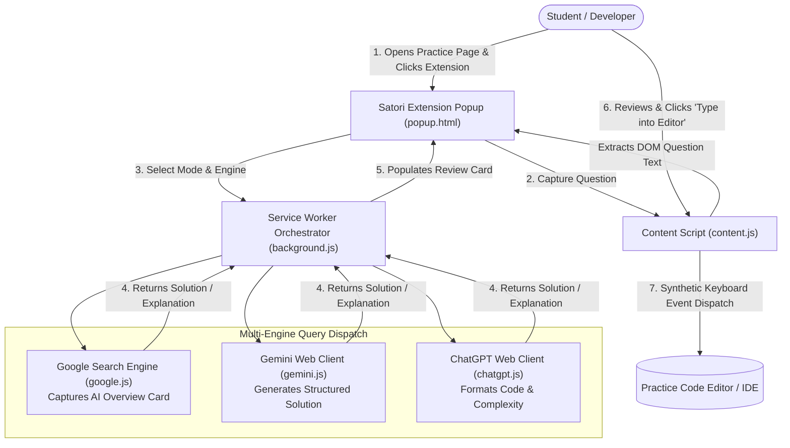

# Satori — AI-Powered Practice & Study Assistant

[](https://developer.chrome.com/docs/extensions/mv3/)
[](https://developer.mozilla.org/en-US/docs/Web/JavaScript)
[]()
[]()

A lightweight, local Google Chrome extension designed to assist students and programmers during coding practice and multiple-choice questions (MCQs). It seamlessly captures problem descriptions, queries AI overview engines (Google Search AI, Gemini, and ChatGPT) without requiring paid API keys, and offers an intelligent synthetic typing injector for code editors with clipboard restrictions.

---

## 🏛️ Extension Workflow & Query Architecture



---

## ✨ Core Features

1. **Zero-API Cloud Integration:**
   * Utilizes the user's existing authenticated browser sessions across Google Search AI Overview, Google Gemini, and OpenAI ChatGPT without requiring paid API keys or exposing developer credentials.
2. **Context-Aware Question Capture:**
   * Automatically parses problem headers, input/output specifications, constraints, and MCQ options directly from the active tab's DOM.
3. **Synthetic Keystroke Simulation:**
   * Many academic practice platforms restrict standard `Ctrl+V` clipboard pasting. Satori simulates native `KeyboardEvent` (`keydown`, `keypress`, `keyup`) sequences, typing the reviewed solution directly into the focused editor element.
4. **Human-in-the-Loop Review:**
   * Prevents automated blind submissions. The extension strictly requires the user to review, edit, and manually verify solutions before inserting them into practice editors.

---

## 🚀 Installation & Local Setup

### 1. Clone the Repository
```bash
git clone https://github.com/shutkarshX/satori.git
```

### 2. Load into Google Chrome
1. Open Google Chrome and navigate to `chrome://extensions/`.
2. Toggle on **Developer mode** in the upper-right corner.
3. Click the **Load unpacked** button.
4. Select your local `satori` directory (the folder containing `manifest.json`).
5. Pin **Satori** to your Chrome toolbar.

---

## 📋 How to Use

1. **Focus the Editor:** Click into the assignment answer box or code editor.
2. **Open Satori:** Click the extension icon in the toolbar.
3. **Select Mode:** Choose between **MCQ** (Multiple Choice) or **Coding**.
4. **Capture:** Click **Read Current Question**. If unrelated text exists on page, highlight the question text first.
5. **Solve:** Click **Search Google & Show AI Result**. Satori retrieves the AI breakdown.
6. **Review & Type:** Inspect the generated solution in the review box. Once verified, click **Type into Focused Assignment Editor** to stream the code into your workspace.

---

## 📂 Repository Structure

```text
satori/
├── background.js              # Central MV3 background orchestrator & multi-tab manager
├── content.js                 # DOM question extractor & synthetic typing injector
├── google.js                  # Google Search DOM observer & AI Overview scraper
├── gemini.js                  # Google Gemini web client automation hook
├── chatgpt.js                 # ChatGPT web client automation hook
├── popup.html                 # Extension toolbar UI
├── popup.js                   # UI event handlers & prompt builders
├── popup.css                  # Modern dark-mode styling
├── manifest.json              # Chrome Extension Manifest V3 configuration
└── README.md
```

---

## 📜 Ethical Use & Academic Disclaimer
* Satori is designed strictly as an **educational study aid** and practice companion.
* Users must adhere to their institution's academic integrity policies. Satori does not auto-submit assignments and should only be used where AI-assisted learning is explicitly permitted.
